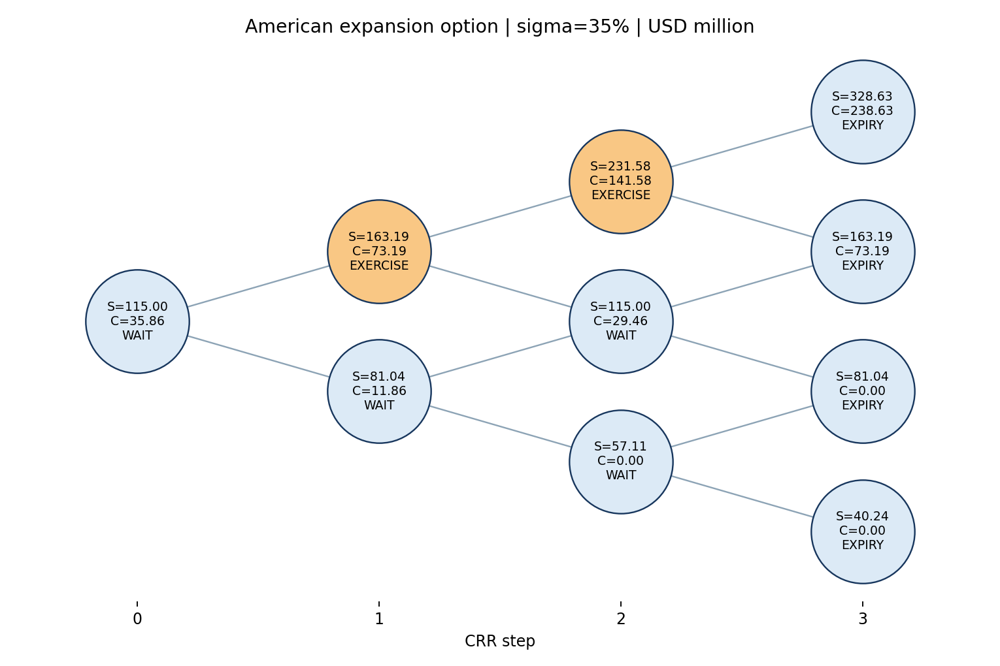
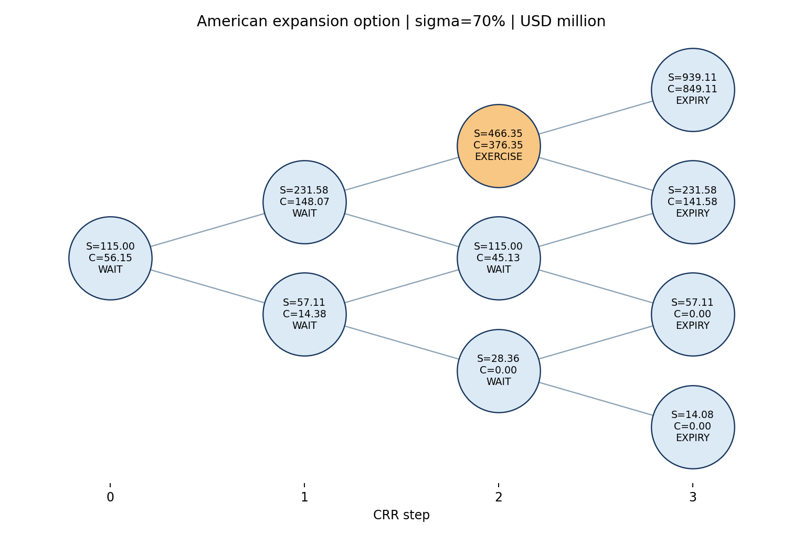

# Итоговый отчёт. Практическая работа № 2 ФИП

## 1. Цель и задачи работы

Цель — оценить управленческую гибкость модульной чистой комнаты для EUV-фоторезистов методом американского опциона CRR. Расчёт проходит путь PDF → CSV → валидация → CRR → Excel Ground Truth → сверка → граничные тесты → сценарий → Harness Log → отчёт.

## 2. Объект исследования

Объект: Cleanroom Shell-and-Core для фоторезистов EUV-литографии. Первая очередь включает чистую комнату ISO 1 и стартовую линию; вторая очередь приобретается по решению менеджмента в течение трёх лет. Масштаб расширения m=100% означает дополнительные потоки, эквивалентные базовым (задание, стр. 5).

## 3. Исходные данные и контроль качества входа

| Параметр | Значение | Единица | Стр. PDF |
| --- | --- | --- | --- |
| I0 | 125.000000 | млн долл. | 5 |
| S0 | 115.000000 | млн долл. | 5 |
| K | 90.000000 | млн долл. | 5 |
| r | 0.060000 | доля/год | 5 |
| sigma | 0.350000 | доля/год | 5 |
| delta | 0.050000 | доля/год | 5 |
| T | 3.000000 | год | 5 |
| N | 3.000000 | шаг | 5 |
| m | 1.000000 | доля | 5 |

Все девять параметров программно извлечены из PDF, сохранены с исходным написанием и страницей 5 в CSV, повторно загружены и проверены. Проценты переведены в доли. Контрольное значение ROV=35,85 млн долл. на стр. 8 задания отличается от полного расчёта на 0,00992 млн долл.; при обычном округлении до сотых получается 35,86. Вероятна усечённая запись или промежуточное округление, но способ в PDF не указан.

## 4. Архитектура расчётного решения

PDF → anchored parser → source_data.csv → ProjectInputData → validation → CRR → независимые формулы Excel → пересчёт/сверка → stress tests → сценарный анализ → Harness Log → Markdown и Word. При невозможности пересчёта Excel значения остаются неподтверждёнными.

## 5. Методика расчёта

NPV_trad=S0−I0 (млн долл.); dt=T/N (год); u=exp(σ√dt), d=1/u; p=[exp((r−δ)dt)−d]/(u−d); дисконтирование exp(−r·dt). Безарбитражное условие d<exp((r−δ)dt)<u. S[i,j]=S0·m·u^j·d^(i−j), млн долл.; C[N,j]=max(S[N,j]−K,0); C[i,j]=max(max(S[i,j]−K,0),exp(−r·dt)[p·C[i+1,j+1]+(1−p)·C[i+1,j]]). ROV=C[0,0]; NPV_strat=NPV_trad+ROV. Здесь S — PV дополнительных потоков, K — CAPEX второй очереди, T — окно решения, σ — неопределённость, δ — цена отсрочки, m — масштаб расширения.

## 6. Результаты расчёта

| Метрика | Значение | Единица |
| --- | --- | --- |
| NPV_trad | -10.000000 | млн долл. |
| dt | 1.000000 | год |
| u | 1.419068 | коэффициент |
| d | 0.704688 | коэффициент |
| p | 0.427451 | вероятность |
| ROV | 35.859920 | млн долл. |
| NPV_strat | 25.859920 | млн долл. |
| ROV shock 70% | 56.154282 | млн долл. |
| NPV_strat shock | 46.154282 | млн долл. |

Базовый DCF отрицателен (-10.00 млн долл.), а опцион на расширение добавляет 35.86 млн долл. и даёт стратегический NPV 25.86 млн долл. Это оценка гибкости, зависящая от допущений и права отказаться от расширения.

Раннее исполнение: 2 узла(ов); критерий строго Intrinsic > Continuation. Узлы перечислены ниже.

| i | j | S | Intrinsic | Continuation | C | Decision |
| --- | --- | --- | --- | --- | --- | --- |
| 1 | 1 | 163.192768 | 73.192768 | 72.882153 | 73.192768 | EXERCISE |
| 2 | 2 | 231.581561 | 141.581561 | 135.528387 | 141.581561 | EXERCISE |

## 7. Harness Log

Сверка Python ↔ Excel: PASS: 28 из 28 значений. Unit tests: PASS. Всего записей о замечаниях: 2.

| Этап | Статус | Факт |
| --- | --- | --- |
| stress | WARNING | Degenerate CRR violates no-arbitrage: No-arbitrage violation: d=0.9999000049998333, growth=1.010050167084168, u=1.0001000050001667; r=0.06, delta=0.05, dt=1.0 |
| source reference | WARNING | PDF p.8 cites ROV=35.85; full-precision model gives 35.85991990; ordinary two-decimal rounding gives 35.86 |

## 8. Тестирование и сценарный анализ

| Тест | Статус | ROV | NPV_strat | Факт |
| --- | --- | --- | --- | --- |
| sigma=0.0001 | WARNING | None | None | Degenerate CRR violates no-arbitrage: No-arbitrage violation: d=0.9999000049998333, growth=1.010050167084168, u=1.0001000050001667; r=0.06, delta=0.05, dt=1.0 |
| K=1e9 | PASS | 0.000000 | -10.000000 | Useless expansion option |
| p_override=1 | PASS | 199.320429 | 189.320429 | synthetic probability override; backward induction only |
| arbitrage violation | PASS | None | None | Controlled exception for r=0.2, T=6, N=1: No-arbitrage violation: d=0.4242970794681834, growth=2.45960311115695, u=2.3568392251330277; r=0.2, delta=0.05, dt=6.0 |

| Метрика | База | σ=70% | Изменение |
| --- | --- | --- | --- |
| ROV | 35.859920 | 56.154282 | 20.294362 |
| NPV_strat | 25.859920 | 46.154282 | 20.294362 |

### Аудит волатильности

Заявление NPV −30 → +15 млн долл. при σ=75% требует независимой проверки σ: источник и сырые ряды; период, частота, размер выборки, annualization; структурные сдвиги и выбор окна; аналоги и twin security; физические драйверы, цены сырья и продукции, корреляции; риск двойного учёта; независимое воспроизведение и чувствительность ROV. Числа кейса не используются как результат данного проекта.

| σ | ROV | NPV_strat | Статус |
| --- | --- | --- | --- |
| 0.100000 | 25.266462 | 15.266462 | PASS |
| 0.200000 | 28.562900 | 18.562900 | PASS |
| 0.300000 | 33.098680 | 23.098680 | PASS |
| 0.350000 | 35.859920 | 25.859920 | PASS |
| 0.400000 | 38.834786 | 28.834786 | PASS |
| 0.500000 | 44.883115 | 34.883115 | PASS |
| 0.600000 | 50.672533 | 40.672533 | PASS |
| 0.700000 | 56.154282 | 46.154282 | PASS |
| 0.750000 | 58.768780 | 48.768780 | PASS |
| 0.800000 | 61.294717 | 51.294717 | PASS |

## 9. Визуализация результатов

Базовая и стрессовая решётки содержат S, C и решение в каждом узле; узлы раннего исполнения выделены цветом.

Рисунок 1 — CRR, σ=35%.

Рисунок 2 — CRR, σ=70%.

## 10. Допущения и качество данных

Все девять параметров программно извлечены из PDF, сохранены с исходным написанием и страницей 5 в CSV, повторно загружены и проверены. Проценты переведены в доли. Контрольное значение ROV=35,85 млн долл. на стр. 8 задания отличается от полного расчёта на 0,00992 млн долл.; при обычном округлении до сотых получается 35,86. Вероятна усечённая запись или промежуточное округление, но способ в PDF не указан.

Модель использует три годовых шага, постоянные r, σ и δ и предполагает выполнимость решения об инвестиции в узле. Эмпирическое подтверждение σ, будущий cash burn и данные по долгу в задании отсутствуют. Поэтому ROV — оценка при заданных допущениях, а не денежное обеспечение.

## 11. Анализ результатов и ограничения

При росте σ с 35% до 70% ROV меняется с 35.86 до 56.15 млн долл. Выпуклая функция max(S−K,0) ограничивает потери нулём и сохраняет выигрыш при высоком S; менеджмент не обязан исполнять опцион. Рост стоимости гибкости не доказывает привлекательность любого рискованного проекта.

Ожидание на TRL 4 требует расходов на чистую комнату, микроклимат, utilities, газы, персонал, патенты и сервис; также возможны устаревание и упущенная выгода. δ отражает экономическую цену задержки, но фактический cash burn должен моделироваться отдельно при наличии данных. Его агрегирование в δ — ограничение.

ROV зависит от σ и будущих решений, не является гарантированным денежным потоком или обеспечением кредита. DSCR=Cash Flow Available for Debt Service / Debt Service; порог задания ≥1,30×. Численный DSCR не рассчитывается вследствие отсутствия необходимых параметров обслуживания долга.

## 12. Итоговые выводы

Базовый DCF отрицателен (-10.00 млн долл.), а опцион на расширение добавляет 35.86 млн долл. и даёт стратегический NPV 25.86 млн долл. Это оценка гибкости, зависящая от допущений и права отказаться от расширения.

Сверка: PASS: 28 из 28 значений; тесты: PASS.

Источник: Задание к практическому занятию 2 ФИП, стр. 1–8. Все численные результаты получены программой из source_data.csv.
