# Итоги практической работы 4

Статус: COMPLETED_WITH_LIMITATIONS

## 01. Цель, объект и источники

| Источник / параметр | Значение | Единица |
| --- | --- | --- |
| Задание 4 | 15 | страниц |
| Лекция 7 | 32 | слайда |
| Базовый CAPEX | 220000000.0 | USD |
| Мощность | 500000.0 | м²/год |
| Постоянный OPEX | 5000000.0 | USD/год |
| Горизонт | 10.0 | эквивалентных лет |
| NWC | 4000000.0 | USD |
| WACC | 8.5 | %/год |

Сравнивается Greenfield-завод PFSA-мембран и мембранно-электродных блоков для PEM-электролизеров. Основной критерий — Parent NPV. Параметры извлечены из текстового слоя и геометрических ячеек таблиц PDF, сохранены в восьми нормализованных CSV и повторно прочитаны в frozen dataclass. Извлечено 136 числовых записей с исходным текстом, страницей, единицей и статусом. Полные исходы — data/*.csv; SHA256 и размеры — source_manifest.json/run_manifest.json. Контрольные удельные цены всех трех стран подтверждены; значения не подменялись итогами прошлых практических работ. Учебные налоговые условия не заявляются как актуальное законодательство.

## 02. Архитектура и воспроизводимость

| Уровень | Ответственность |
| --- | --- |
| ApplicationInterface | CLI, конфигурация, код возврата |
| PipelineController | Стадии 00–15 и журналирование |
| PdfExtractionService → DataRepository | PDF → CSV → неизменяемые DTO |
| CrossBorderSupplyChainEvaluator | Композиция чистых калькуляторов |
| ScenarioService | Новые объекты A/B/C, edge и stress |
| ExcelGroundTruthWriter / ComparisonService | Независимые формулы и сверка реального кэша |
| ChartService / ReportService | Общие CSV и связанные таблица → график → анализ |
| HarnessLogWriter / ArtifactService | Аудит, manifest, ZIP |

Один запуск: python 4/app/main.py. Формулы отсутствуют в интерфейсе, контроллере и DTO. Каждый калькулятор решает узкую математическую задачу и не читает файлы. Тесты и Excel worker запускаются контроллером; субагенты не используются. План и реестры: docs/implementation_plan.md, formula_registry.md, requirements_traceability.md. GRP задания обозначается CRP. Слайды 3–7 лекции7 задают риск; 21–24 — субсидии и потоки; 25–26 — налоговый минимум и WHT. Где лекция не дает отдельной формулы IRR/PI/DPP, определение явно является решением модели.

## 03. Страновой и геополитический риск

| Страна | WACC, % | CRP, % | GPR, % | r_adj, % |
| --- | --- | --- | --- | --- |
| DEU | 8.5 | 0.0 | 0.6 | 9.100000000000001 |
| SRB | 8.5 | 3.4999999999999996 | 5.1000000000000005 | 17.099999999999998 |
| VNM | 8.5 | 3.375 | 3.8000000000000007 | 15.675 |

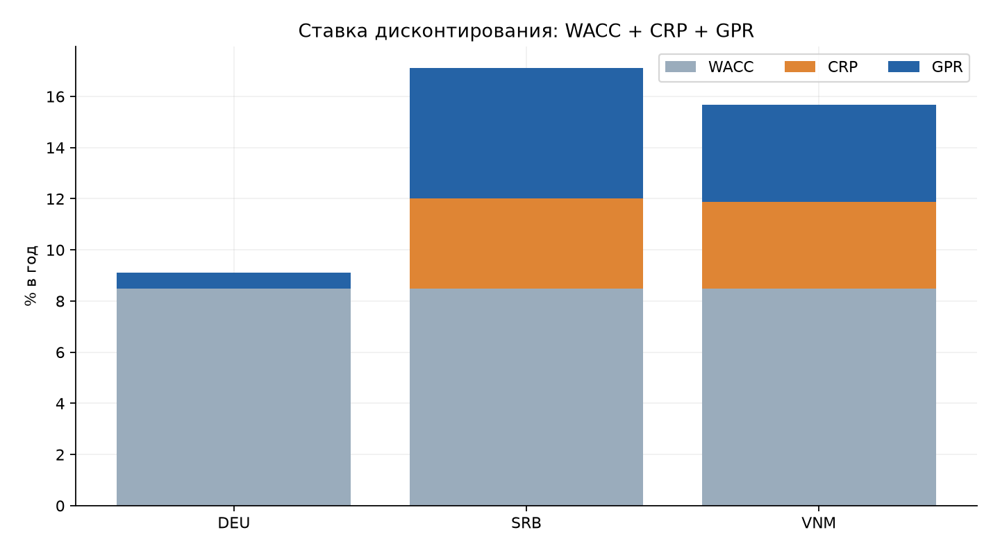

DEU: r_adj=9.100%; SRB: r_adj=17.100%; VNM: r_adj=15.675%. У SRB GPR=5.10% при IGPR=250; у VNM CRP=3.375%. Разница ставок уменьшает PV поздних поступлений. Gamma конвертирована из п.п./σ в долю/σ. Рост IGPR меняет ставку, но не создает произвольное сокращение выручки; заданный фрахтовый стресс моделируется отдельно в OPEX.

## 04. CAPEX и ожидаемая субсидия

| Страна | Gross, млн USD | PV субсидии, млн USD | Net, млн USD | Год субсидии |
| --- | --- | --- | --- | --- |
| DEU | 308.0 | 45.06379697362942 | 262.9362030263706 | 4.0 |
| SRB | 252.99999999999997 | 24.19312499999999 | 228.80687499999996 | 0.0 |
| VNM | 266.20000000000005 | 20.53081802301088 | 245.6691819769892 | 5.0 |

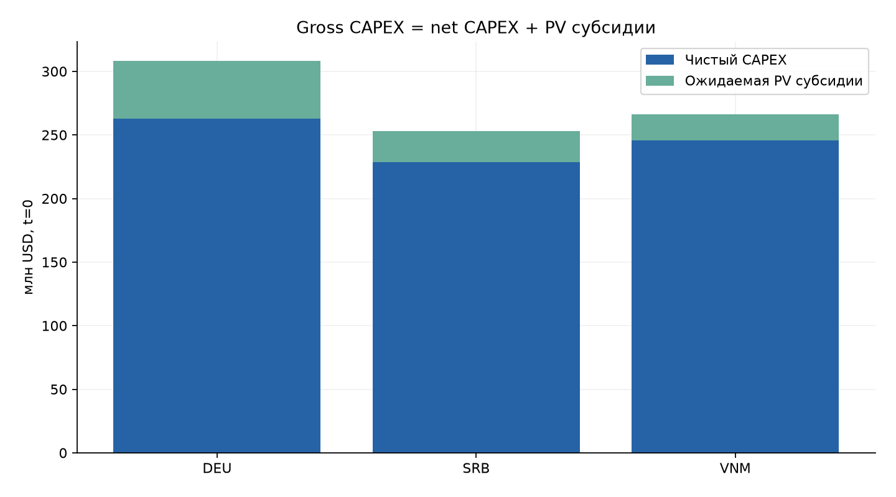

Чистые инвестиции: DEU 262.936 млн USD; SRB 228.807 млн USD; VNM 245.669 млн USD. Субсидия умножается на вероятность одобрения и сохранения гранта, затем дисконтируется по доходности суверенных облигаций. Это ожидаемая приведенная оценка, а не гарантированный денежный грант. Вся PV уже уменьшает CF0 и базу амортизации. В год фактического перечисления второй положительный CF не создается. В SRB пошлина на оборудование 1% нейтрализована duty_free=1.

## 05. Сырье, рынки, логистика и CBAM

| Страна | Сырье base | Сырье landed | Цена weighted | Цена net | CBAM/м² | Lead time, дней |
| --- | --- | --- | --- | --- | --- | --- |
| DEU | 70.0 | 72.1 | 180.0 | 176.4 | 0.0 | 5.0 |
| SRB | 62.0 | 66.96 | 174.0 | 165.3 | 0.0 | 35.0 |
| VNM | 62.0 | 66.96 | 166.0 | 152.22 | 2.16 | 14.0 |

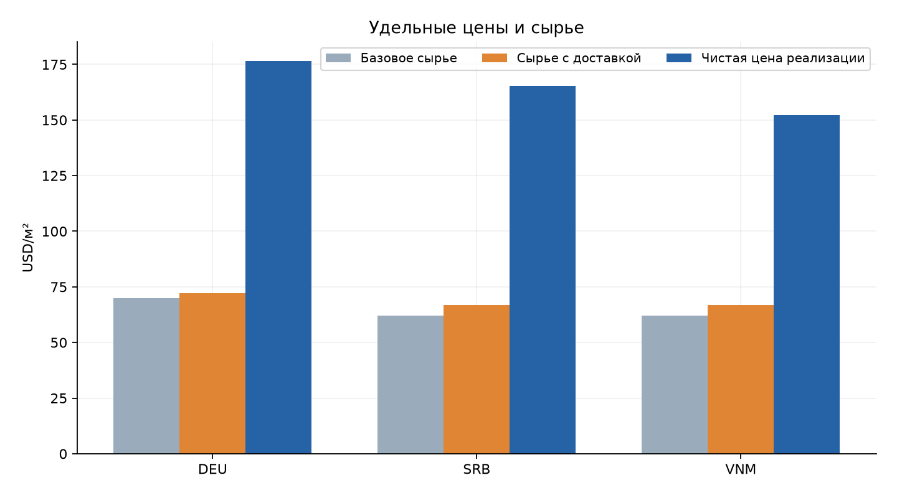

Все удельные денежные значения — USD/м². У VNM 166×(1−0,07)−0,30×180×0,04=152.22 USD/м²; CBAM составляет 2.16 USD/м² всего выпуска и относится только к ЕС. Сырье SRB и VNM имеет одинаковую landed-стоимость при разных сочетаниях фрахта и пошлин. Пошлина на оборудование не повторяется в OPEX, входная логистика не включается в стоимость реализации. Конкретная матрица рынков таблицы2 имеет приоритет перед общим описанием 85% экспорта на стр.2.

## 06. Календарь, амортизация и NWC

| Страна | Первый t | Последний t | Load first/last | Σ экв. лет | Σ D&A, млн USD | NWC draw/release t |
| --- | --- | --- | --- | --- | --- | --- |
| DEU | 4.0 | 13.0 | 1/1 | 10.0 | 262.9362030263706 | 3/13 |
| SRB | 3.0 | 12.0 | 1/1 | 10.0 | 228.80687499999996 | 2/12 |
| VNM | 3.0 | 13.0 | 0.5/0.5 | 10.0 | 245.6691819769892 | 2/13 |

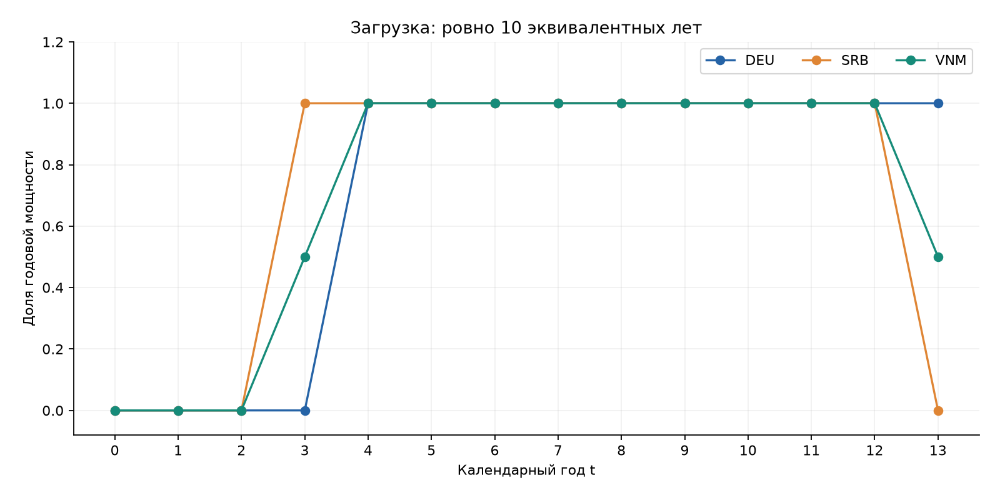

Начало эксплуатации — DEU t4, SRB t3, VNM t3. У VNM первая и последняя точки загрузки равны 0,5; девять промежуточных лет — 1. Сумма нагрузок каждого завода равна 10, сумма D&A — соответствующему net CAPEX. В полугодиях VNM постоянный OPEX равен 2,5 млн USD. NWC_cash_effect = −4 млн при вложении и +4 млн при возврате, сумма равна нулю. NWC_change имеет противоположный знак и вычитается из FCFF. Подтвержденные календарные границы и события NWC сохранены в chart_features.csv; перегибы и асимптоты не утверждаются.

## 07. Годовые локальные и материнские денежные потоки

| Страна | t | Revenue | OPEX | CIT | NWC cash | Local CF | Parent CF |
| --- | --- | --- | --- | --- | --- | --- | --- |
| DEU | 0 | 0.0 | 0.0 | 0.0 | -0.0 | -262.9362030263706 | -262.9362030263706 |
| DEU | 1 | 0.0 | 0.0 | 0.0 | -0.0 | 0.0 | 0.0 |
| DEU | 2 | 0.0 | 0.0 | 0.0 | -0.0 | 0.0 | 0.0 |
| DEU | 3 | 0.0 | 0.0 | 0.0 | -4.0 | -4.0 | -4.0 |
| DEU | 4 | 88.2 | 41.05 | 5.215201149814156 | -0.0 | 41.93479885018584 | 41.93479885018584 |
| DEU | 5 | 88.2 | 41.05 | 5.215201149814156 | -0.0 | 41.93479885018584 | 41.93479885018584 |
| DEU | 6 | 88.2 | 41.05 | 5.215201149814156 | -0.0 | 41.93479885018584 | 41.93479885018584 |
| DEU | 7 | 88.2 | 41.05 | 5.215201149814156 | -0.0 | 41.93479885018584 | 41.93479885018584 |
| DEU | 8 | 88.2 | 41.05 | 5.215201149814156 | -0.0 | 41.93479885018584 | 41.93479885018584 |
| DEU | 9 | 88.2 | 41.05 | 5.215201149814156 | -0.0 | 41.93479885018584 | 41.93479885018584 |
| DEU | 10 | 88.2 | 41.05 | 5.215201149814156 | -0.0 | 41.93479885018584 | 41.93479885018584 |
| DEU | 11 | 88.2 | 41.05 | 5.215201149814156 | -0.0 | 41.93479885018584 | 41.93479885018584 |
| DEU | 12 | 88.2 | 41.05 | 5.215201149814156 | -0.0 | 41.93479885018584 | 41.93479885018584 |
| DEU | 13 | 88.2 | 41.05 | 5.215201149814156 | 4.0 | 45.93479885018584 | 45.93479885018584 |
| SRB | 0 | 0.0 | 0.0 | 0.0 | -0.0 | -228.80687499999996 | -228.80687499999996 |
| SRB | 1 | 0.0 | 0.0 | 0.0 | -0.0 | 0.0 | 0.0 |
| SRB | 2 | 0.0 | 0.0 | 0.0 | -4.0 | -4.0 | -4.0 |
| SRB | 3 | 82.65 | 38.48 | 3.1933968750000004 | -0.0 | 40.976603125 | 38.92777296875 |
| SRB | 4 | 82.65 | 38.48 | 3.1933968750000004 | -0.0 | 40.976603125 | 38.92777296875 |
| SRB | 5 | 82.65 | 38.48 | 3.1933968750000004 | -0.0 | 40.976603125 | 38.92777296875 |
| SRB | 6 | 82.65 | 38.48 | 3.1933968750000004 | -0.0 | 40.976603125 | 38.92777296875 |
| SRB | 7 | 82.65 | 38.48 | 3.1933968750000004 | -0.0 | 40.976603125 | 38.92777296875 |
| SRB | 8 | 82.65 | 38.48 | 3.1933968750000004 | -0.0 | 40.976603125 | 38.92777296875 |
| SRB | 9 | 82.65 | 38.48 | 3.1933968750000004 | -0.0 | 40.976603125 | 38.92777296875 |
| SRB | 10 | 82.65 | 38.48 | 3.1933968750000004 | -0.0 | 40.976603125 | 38.92777296875 |
| SRB | 11 | 82.65 | 38.48 | 3.1933968750000004 | -0.0 | 40.976603125 | 38.92777296875 |
| SRB | 12 | 82.65 | 38.48 | 3.1933968750000004 | 4.0 | 44.976603125 | 42.92777296875 |
| SRB | 13 | 0.0 | 0.0 | 0.0 | -0.0 | 0.0 | 0.0 |
| VNM | 0 | 0.0 | 0.0 | 0.0 | -0.0 | -245.6691819769892 | -245.6691819769892 |
| VNM | 1 | 0.0 | 0.0 | 0.0 | -0.0 | 0.0 | 0.0 |
| VNM | 2 | 0.0 | 0.0 | 0.0 | -4.0 | -4.0 | -4.0 |
| VNM | 3 | 38.055 | 19.24 | 0.9797311351725811 | -0.0 | 17.835268864827416 | 16.051741978344676 |
| VNM | 4 | 76.11 | 38.48 | 1.9594622703451623 | -0.0 | 35.67053772965483 | 32.10348395668935 |
| VNM | 5 | 76.11 | 38.48 | 1.9594622703451623 | -0.0 | 35.67053772965483 | 32.10348395668935 |
| VNM | 6 | 76.11 | 38.48 | 1.9594622703451623 | -0.0 | 35.67053772965483 | 32.10348395668935 |
| VNM | 7 | 76.11 | 38.48 | 1.9594622703451623 | -0.0 | 35.67053772965483 | 32.10348395668935 |
| VNM | 8 | 76.11 | 38.48 | 1.9594622703451623 | -0.0 | 35.67053772965483 | 32.10348395668935 |
| VNM | 9 | 76.11 | 38.48 | 1.9594622703451623 | -0.0 | 35.67053772965483 | 32.10348395668935 |
| VNM | 10 | 76.11 | 38.48 | 1.9594622703451623 | -0.0 | 35.67053772965483 | 32.10348395668935 |
| VNM | 11 | 76.11 | 38.48 | 1.9594622703451623 | -0.0 | 35.67053772965483 | 32.10348395668935 |
| VNM | 12 | 76.11 | 38.48 | 2.612616360460217 | -0.0 | 35.01738363953979 | 31.515645275585808 |
| VNM | 13 | 38.055 | 19.24 | 1.3063081802301084 | 4.0 | 21.508691819769894 | 19.757822637792906 |

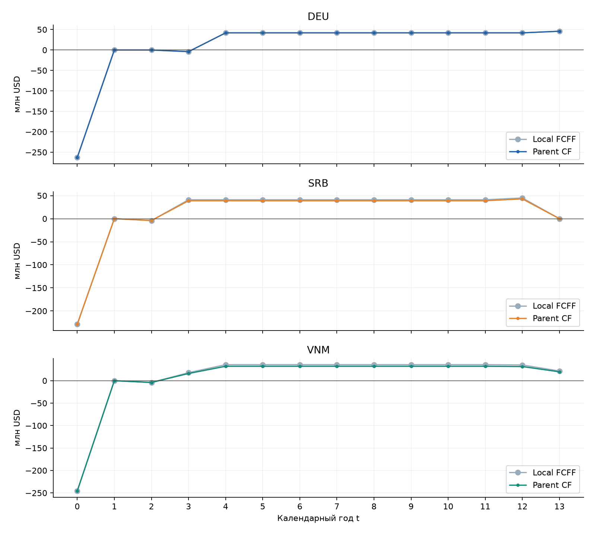

Денежные столбцы в млн USD, без округления в расчетах. CAPEX находится только в t0, NWC — в заданные годы. WHT уменьшает только положительный операционный поток после CIT. Принято распределение 100% такого потока: отсутствие payout ratio и юридических ограничений раскрыто как допущение. Стоимость WHT по NPV: DEU 0.000 млн USD; SRB 6.935 млн USD; VNM 12.142 млн USD. После завершения SRB в t12 строка t13 нулевая. Весь общий календарь 0…13 сохраняется в метриках; нулевые годы до ввода не сжимаются.

## 08. Накопленный дисконтированный поток и DPP

| Страна | Конечный CumPV, млн USD | DPP | Статус |
| --- | --- | --- | --- |
| DEU | -58.39472240410853 | — | NOT_REACHED |
| SRB | -99.35005625274904 | — | NOT_REACHED |
| VNM | -138.77800732773503 | — | NOT_REACHED |

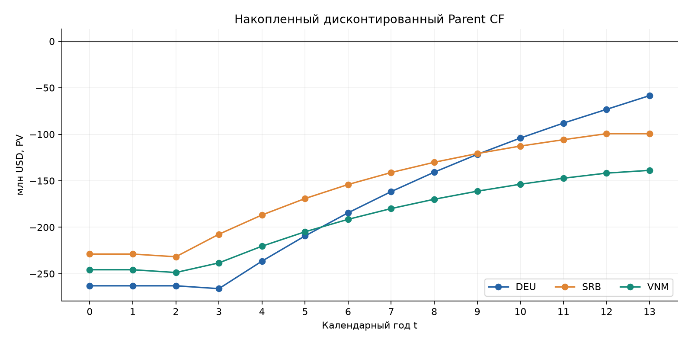

Кривые не достигают нуля к окончанию проекта: DPP=NOT_REACHED у всех стран. Число лет окупаемости за пределами наблюдаемого горизонта не экстраполируется. Каждое поступление дисконтируется по фактическому календарному t; задержка запуска ухудшает PV, даже если эквивалентный объем производства одинаков. Терминальная стоимость TV=0, поскольку методика ее расчета не задана.

## 09. Налоги, R&D credit и Pillar 2

| Страна | t | EBIT, млн USD | Режим, % | Credit, млн USD | CIT, млн USD |
| --- | --- | --- | --- | --- | --- |
| DEU | 4 | 20.85637969736294 | 29.799999999999997 | 1.0 | 5.215201149814156 |
| DEU | 5 | 20.85637969736294 | 29.799999999999997 | 1.0 | 5.215201149814156 |
| DEU | 6 | 20.85637969736294 | 29.799999999999997 | 1.0 | 5.215201149814156 |
| DEU | 7 | 20.85637969736294 | 29.799999999999997 | 1.0 | 5.215201149814156 |
| DEU | 8 | 20.85637969736294 | 29.799999999999997 | 1.0 | 5.215201149814156 |
| DEU | 9 | 20.85637969736294 | 29.799999999999997 | 1.0 | 5.215201149814156 |
| DEU | 10 | 20.85637969736294 | 29.799999999999997 | 1.0 | 5.215201149814156 |
| DEU | 11 | 20.85637969736294 | 29.799999999999997 | 1.0 | 5.215201149814156 |
| DEU | 12 | 20.85637969736294 | 29.799999999999997 | 1.0 | 5.215201149814156 |
| DEU | 13 | 20.85637969736294 | 29.799999999999997 | 1.0 | 5.215201149814156 |
| SRB | 3 | 21.289312500000005 | 15.0 | 0.0 | 3.1933968750000004 |
| SRB | 4 | 21.289312500000005 | 15.0 | 0.0 | 3.1933968750000004 |
| SRB | 5 | 21.289312500000005 | 15.0 | 0.0 | 3.1933968750000004 |
| SRB | 6 | 21.289312500000005 | 15.0 | 0.0 | 3.1933968750000004 |
| SRB | 7 | 21.289312500000005 | 15.0 | 0.0 | 3.1933968750000004 |
| SRB | 8 | 21.289312500000005 | 15.0 | 0.0 | 3.1933968750000004 |
| SRB | 9 | 21.289312500000005 | 15.0 | 0.0 | 3.1933968750000004 |
| SRB | 10 | 21.289312500000005 | 15.0 | 0.0 | 3.1933968750000004 |
| SRB | 11 | 21.289312500000005 | 15.0 | 0.0 | 3.1933968750000004 |
| SRB | 12 | 21.289312500000005 | 15.0 | 0.0 | 3.1933968750000004 |
| VNM | 3 | 6.531540901150541 | 15.0 | 0.0 | 0.9797311351725811 |
| VNM | 4 | 13.063081802301083 | 15.0 | 0.0 | 1.9594622703451623 |
| VNM | 5 | 13.063081802301083 | 15.0 | 0.0 | 1.9594622703451623 |
| VNM | 6 | 13.063081802301083 | 15.0 | 0.0 | 1.9594622703451623 |
| VNM | 7 | 13.063081802301083 | 15.0 | 0.0 | 1.9594622703451623 |
| VNM | 8 | 13.063081802301083 | 15.0 | 0.0 | 1.9594622703451623 |
| VNM | 9 | 13.063081802301083 | 15.0 | 0.0 | 1.9594622703451623 |
| VNM | 10 | 13.063081802301083 | 15.0 | 0.0 | 1.9594622703451623 |
| VNM | 11 | 13.063081802301083 | 15.0 | 0.0 | 1.9594622703451623 |
| VNM | 12 | 13.063081802301083 | 20.0 | 0.0 | 2.612616360460217 |
| VNM | 13 | 6.531540901150541 | 20.0 | 0.0 | 1.3063081802301084 |

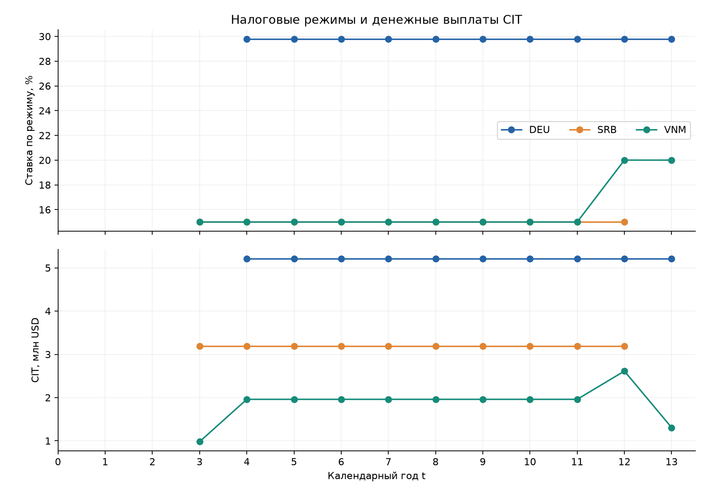

VNM: t3–11 15%, t12–13 20%; SRB: 15% от прямых продаж без IP Box; DEU: 29,80% до годового R&D credit 1 млн USD, с ограничением пола 15%. Напечатанная формула для отрицательного EBIT сохранена как контрольная; основная модель не создает неподтвержденных денежных налоговых возвратов. Эффект замены cash_tax буквальной формулой на базовый Parent NPV: DEU 0.000000 млн USD; SRB 0.000000 млн USD; VNM 0.000000 млн USD. В данном наборе входов это не означает эквивалентности методов при убытках.

## 10. Базовые инвестиционные показатели

| Страна / поток | NPV, млн USD | IRR, % | PI | PV+, млн USD | |PV−|, млн USD | DPP |
| --- | --- | --- | --- | --- | --- | --- |
| DEU / local | -58.39472240410853 | 5.736165230568546 | 0.7804845448741983 | 207.6217290145089 | 266.0164514186174 | NOT_REACHED |
| DEU / parent | -58.39472240410853 | 5.736165230568546 | 0.7804845448741983 | 207.6217290145089 | 266.0164514186174 | NOT_REACHED |
| SRB / local | -92.41467792597442 | 8.34123076978759 | 0.601186318201463 | 139.30926271019015 | 231.72394063616457 | NOT_REACHED |
| SRB / parent | -99.35005625274904 | 7.5421922914254536 | 0.5712568326777206 | 132.37388438341554 | 231.72394063616457 | NOT_REACHED |
| VNM / local | -126.63599972591582 | 4.786369325880857 | 0.4907233467305392 | 122.02256122113798 | 248.65856094705376 | NOT_REACHED |
| VNM / parent | -138.77800732773503 | 3.3707400624073847 | 0.4418933062301255 | 109.88055361931875 | 248.65856094705376 | NOT_REACHED |

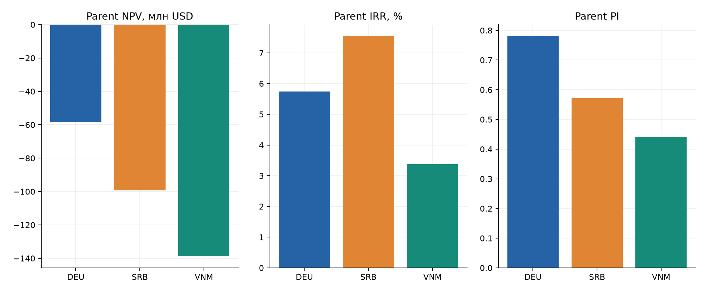

Наименее отрицательный базовый Parent NPV имеет DEU. PI учитывает PV всех инвестиционных оттоков, включая позднее вложение NWC. IRR вычисляется для полного календарного ряда; ищутся все положительные вещественные корни полинома в дисконт-факторе. При отсутствии/множественности корней возвращается статус, а не произвольное число. Во всех базовых локациях IRR ниже r_adj, PI<1 и Parent NPV<0; принять проект только по низкому номинальному налогу нельзя.

## 11. Независимый Excel и проверка численных результатов

| Статус | Число сравнений |
| --- | --- |
| PASS | 10365 |

Сверка выполнена для 10365 ячеек: риски, CAPEX, субсидии, цепочки поставок, все годовые строки, local/Parent/literal метрики, сценарные ожидания и дисперсии. В книге расчетные ячейки содержат формулы, входы отделены. Независимым подтверждением считается только кэш после реального Excel COM. Движок: PASS. Денежный допуск 0,01 USD + 1e−10×|Python|; для ставок/PI/DPP абсолютный допуск 1e−8. Результаты сравниваются до округления; отсутствие кэша не признается совпадением. Полный построчный протокол — reconciliation.csv.

## 12. Граничные проверки и протокол тестирования

| Результат | Количество |
| --- | --- |
| PASS | 62 |

Запущено 62 тестов через subprocess pytest, XML и tests.log сохранены. Zero-Friction обнуляет пошлины, CBAM, входную/выходную логистику, CRP/GPR: ставка остается WACC=8.50%. Отдельная фикстура VNM PILLAR2 задает 0% в первые четыре года и проверяет доначисление до 15% при положительном EBIT. Double Counting проверяет независимость операционных поступлений от абстрактной премии риска и однократное включение логистики. Дополнительно проверены отрицательный EBIT, границы субсидий, WHT=0, NWC, поврежденные входы, единицы, IRR с несколькими корнями, отсутствие Excel-кэша и неверные границы графической оси. Реальные дефекты и SOURCE_ISSUE разделены в HARNESS_LOG.xlsx.

## 13. Обязательные стресс-тесты

| Стресс / страна | База NPV | Стресс NPV | Δ NPV | Базовая r, % | Стресс r, % |
| --- | --- | --- | --- | --- | --- |
| STRESS1 / VNM | -138.77800732773503 | -170.97052701927112 | -32.19251969153607 | 15.675 | 20.515 |
| STRESS2 / SRB | -99.35005625274904 | -113.12650454847753 | -13.776448295728489 | 17.099999999999998 | 17.099999999999998 |

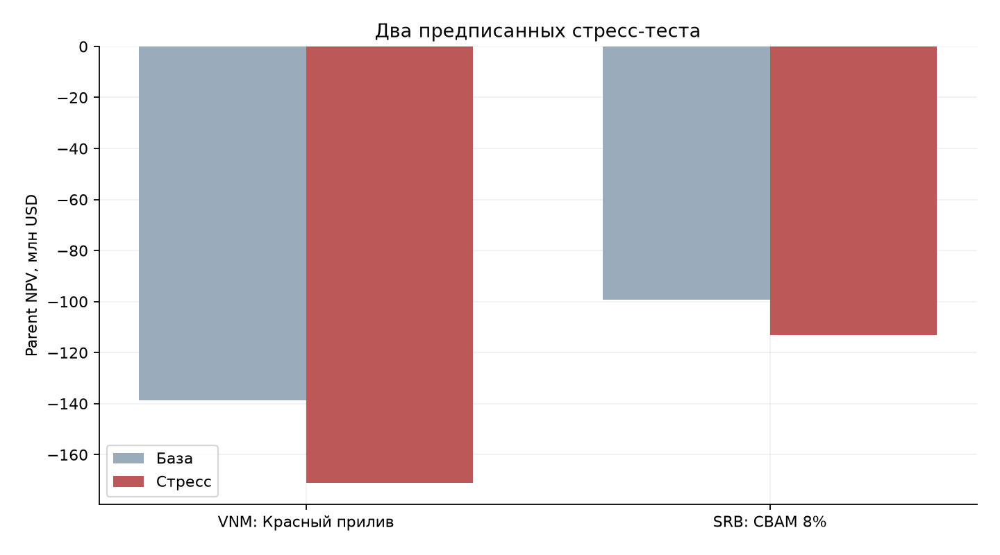

NPV в млн USD. Красный прилив VNM: IGPR=420, входной фрахт 15%, доставка 45 дней. Изменение Parent NPV -32.193 млн USD, OPEX полного года меняется на 3.100 млн USD. Балканский стресс SRB: CBAM 8% только на ЕС; изменение Parent NPV -13.776 млн USD. IP Box ранее не применялся, поэтому налог остается 15%; искусственного налогового скачка нет. Срок доставки не меняет фиксированный NWC. Исходные CSV не изменяются; абсолютные и относительные изменения всех метрик и годовых строк — stress_deltas.csv.

## 14. Три вероятностных макросценария

| Страна | A NPV | Б NPV | В NPV | p(A)/p(Б)/p(В) |
| --- | --- | --- | --- | --- |
| DEU | -55.40720880327238 | -58.39472240410853 | -90.1300365294257 | 0,20 / 0,50 / 0,30 |
| SRB | -85.79643452040168 | -99.35005625274904 | -113.12650454847753 | 0,20 / 0,50 / 0,30 |
| VNM | -102.9897586542218 | -138.77800732773503 | -170.97052701927112 | 0,20 / 0,50 / 0,30 |

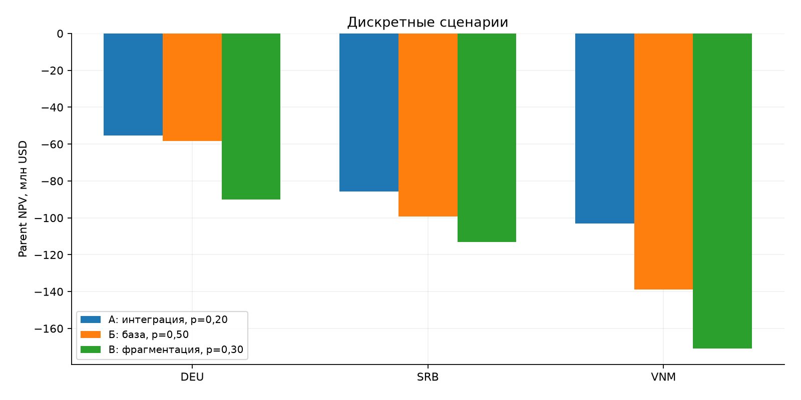

Все NPV в млн USD. A снижает IGPR на 30% и обнуляет пошлины и CBAM, сохраняя транспортные расходы. Б сохраняет исходы. В сочетает оба страновых стресса, а в DEU повышает IGPR на 50% и удорожание CAPEX до 50%. Для каждого набора полностью пересчитываются ставка, чистый CAPEX, D&A, налоги и CF. Благоприятный сценарий не является Zero-Friction: остаточные CRP/GPR и логистика сохраняются.

## 15. Ожидаемая стоимость и дискретный риск

| Рейтинг | Страна | E[NPV], млн USD | Var, USD² | σ, млн USD | P(NPV<0) |
| --- | --- | --- | --- | --- | --- |
| 1 | DEU | -67.31781392153644 | 224302534064408.72 | 14.976733090511052 | 1.0 |
| 2 | SRB | -100.77226639499811 | 91654609017459.78 | 9.57364136666189 | 1.0 |
| 3 | VNM | -141.27811350049322 | 560816714975362.06 | 23.68156909867592 | 1.0 |

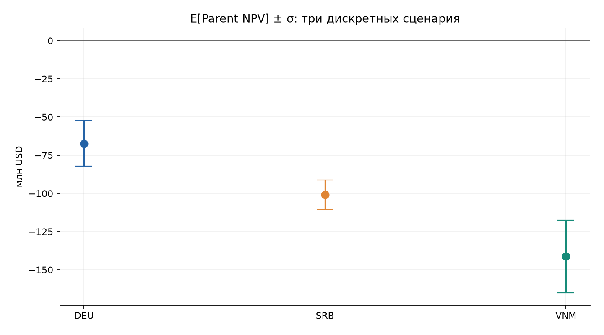

Рейтинг по ожидаемому Parent NPV: DEU → SRB → VNM. Ожидание каждой страны находится между крайними сценарными значениями, вероятности суммируются в 1, дисперсия неотрицательна. Стандартное отклонение измеряется в USD, дисперсия — USD². Полосы E±σ не являются доверительным интервалом нормального распределения. P отрицательного NPV рассчитана только по трем заданным сценариям и не характеризует все возможные будущие состояния.

## 16. Методологический аудит WHT и NWC

| Страна | Economic NPV | Literal PDF NPV | Δ literal | Δ literal tax | Стоимость WHT |
| --- | --- | --- | --- | --- | --- |
| DEU | -58.39472240410853 | -60.185717549879485 | -1.7909951457709596 | 0.0 | 0.0 |
| SRB | -99.35005625274904 | -94.58419410563314 | 4.765862147115901 | 0.0 | 6.935378326774627 |
| VNM | -138.77800732773503 | -128.72395559602802 | 10.054051731707021 | 0.0 | 12.142007601819218 |

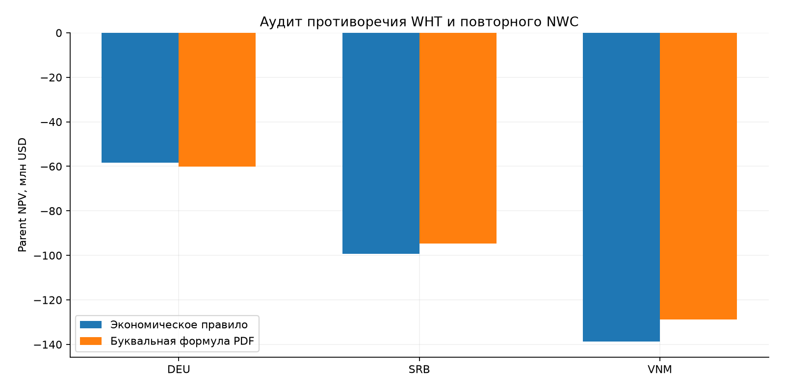

Все значения в млн USD. Буквальная строка PDF прочитана по визуальному рендеру: в отрицательной ветви WHT умножает только ΔNWC; дополнительных скобок вокруг FCFF−ΔNWC нет. Это повторно учитывает движение NWC и не удерживает WHT с положительного операционного CF. Версия маркируется SOURCE_CONFLICT/NON_AUTHORITATIVE. Изменение NPV — методологическая чувствительность, а не допустимая налоговая оптимизация. Даже DEU с WHT=0 имеет расхождение из-за повторного NWC. В инвестиционном выводе используется только economic_rule.

## 17. Однофакторная чувствительность

| Страна | NPV при задержке +1, млн USD | Изменение к базе, млн USD |
| --- | --- | --- |
| DEU | -75.4554691837839 | -17.06074677967538 |
| SRB | -118.2545105702383 | -18.90445431748925 |
| VNM | -153.26272020974974 | -14.48471288201472 |

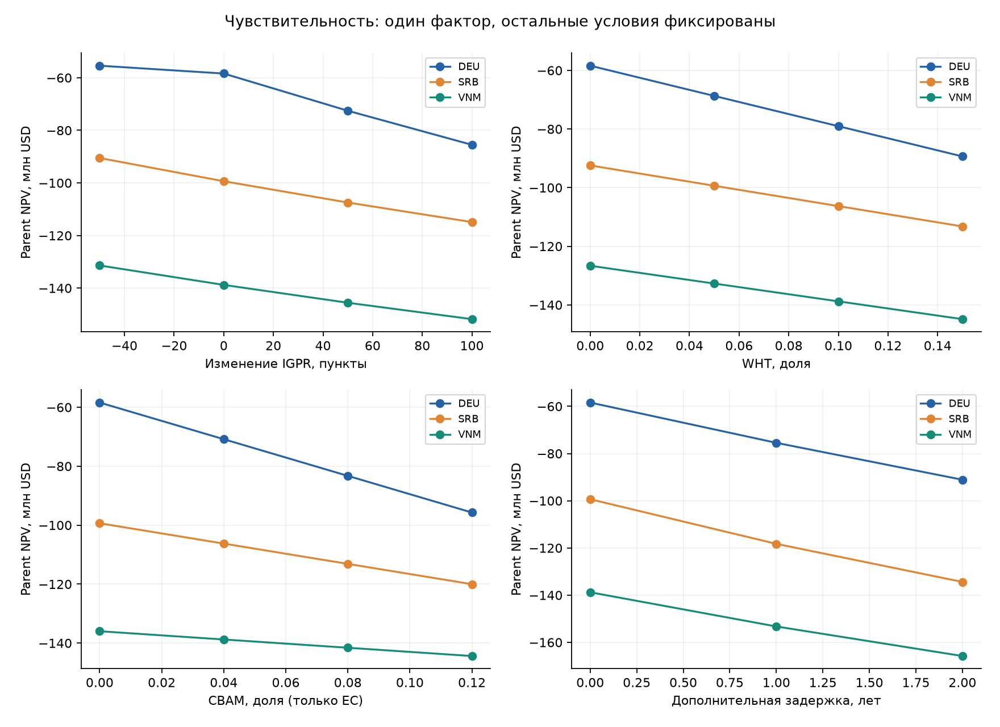

IGPR исследован как приращение к исходному индексу; WHT и CBAM — как абсолютные доли. Дополнительная задержка сдвигает эксплуатацию, NWC и налоговый календарь на целые годы; CF0 и субсидия остаются фиксированными. Это отдельная модельная чувствительность, а не изменение обязательных сценариев PDF. Диапазон конечен, интерполяция только соединяет рассчитанные точки; асимптоты, гладкие экстремумы и перегибы не заявляются. Все исследованные значения сохранены, включая крайние отрицательные NPV.

## 18. Проблемы источника и принятые решения

| ID / PDF | Наблюдение | Решение |
| --- | --- | --- |
| SRC_NWC / 8,13 | Стр.8 ΔNWC назван оттоком −4 млн; стр.13 ΔNWC вычитается из FCFF. | NWC_change=+4 млн при вложении, −4 млн при возврате; cash_effect=−change. Ни CAPEX, ни NWC не облагаются WHT. |
| SRC_WHT / 13 | Текст требует WHT с положительного операционного CF; печатная ветвь: FCFF−ΔNWC*(1−WHT) при FCFF≤0, FCFF−ΔNWC при FCFF>0. | Основной economic_rule; буквальный literal_pdf NON_AUTHORITATIVE сохранен точно по визуально проверенной типографике. Не добавлены отсутствующие скобки вокруг FCFF−ΔNWC. |
| SRC_NEG_TAX / 13 | max(CIT_gross, EBIT*floor) при EBIT<0 может создавать налоговый возврат. | Основной cash_tax=max(0,literal_tax), без переноса убытков. Буквальная формула сохранена отдельно; численный эффект публикуется. |
| SRC_VNM_TAX / 5,14 | База VNM 15% t3–11,20% t12–13; edge case требует 0%→15% в первые 4 года. | Базовый календарь сохраняется; отдельная фикстура PILLAR2 задает 0% t3–6 и проверяет пол при положительном EBIT. |
| SRC_SRB_IP / 5,14 | 3% IP Box относится к роялти, которых у проекта нет. | Налог SRB 15% в базе и стрессе; отмена IP Box не создает искусственного налогового эффекта. |
| SRC_EXPORT / 2,10 | На стр.2 указано 85% экспорта; таблица2 задает полное распределение продукции по рынкам ЕС/Азии. | Для денежной модели приоритет конкретной матрице рынков. Отдельный неназванный внутренний рынок 15% не добавляется. |
| SRC_DEU_CIT / 5 | 29.80% в строке DEU отличается от суммы перечисленных компонентов 15+0.825+14=29.825%. | Применяется явно заданная сводная ставка 29.80%; компоненты остаются в оригинальном тексте CSV. |
| SRC_SUBSIDY_TIME / 7,8,12 | DEU субсидия t4 описана как через год после ввода t3; первый полный CF по календарю t4. | Не смешивать ввод в конце t3 с потоком t4; t_subsidy=4 считывается отдельно, субсидия учтена только в CF0 через PV. |

Эти записи отражают противоречия учебного источника, а не фиктивные ошибки кода. Каждое решение связано с тестами и исходной страницей. Отдельные реальные ошибки реализации с причиной, исправлением и результатом повторной проверки находятся в Harness Log/Fixes.

## 19. Инженерно-экономическое резюме инвестиционному комитету

| Страна | E[ParentNPV], млн USD | σ, млн USD | Решение в рамках модели |
| --- | --- | --- | --- |
| DEU | -67.31781392153644 | 14.976733090511052 | Не принимать при заданных условиях |
| SRB | -100.77226639499811 | 9.57364136666189 | Не принимать при заданных условиях |
| VNM | -141.27811350049322 | 23.68156909867592 | Не принимать при заданных условиях |

Лучший относительный результат у DEU: E[ParentNPV]=-67.318 млн USD при σ=14.977 млн USD. Все три ожидаемых Parent NPV отрицательны. При заданных мощности, ценах, инвестициях, сроках и TV=0 ни одна локация не создает требуемую стоимость; положительную инвестиционную рекомендацию сформировать нельзя. Германия компенсирует более дорогой CAPEX меньшей ставкой риска и лучшей чистой ценой, но поздний запуск и масштаб инвестиций все равно делают NPV отрицательным. Субсидии не устраняют потери от дисконтирования; WHT, CBAM и фрахт ухудшают альтернативы. Для нового решения нужны подтвержденные изменения маржи, CAPEX, графика либо самостоятельная методика остаточной стоимости. Финансирование, юридическая распределяемость CF, валютный и технологический риск не обеспечены исходными данными. Полнота подтверждения исполнения указана в manifest, независимо от инвестиционного вердикта.

## 20. Выдержки Harness Log: фактические дефекты и повторная проверка

| ID / тип | Наблюдение | Исправление / решение | Повторная проверка |
| --- | --- | --- | --- |
| DEV001 / CODE_ERROR | test_calendar[SRB] failed: only t=0..12 returned instead of a common t=0..13 comparison axis | Project.calendar_end is derived from the extracted final years; post-closure years contain zero operating CF | PASS: covered by full current test suite |
| ENV001 / ENVIRONMENT | python alias cannot be accessed; global interpreter lacks dependencies | Prepared independent 4/app/.venv using existing installed dependency distributions; requirements.txt records versions | All dependencies imported |
| DEV002 / CODE_ERROR | Full pipeline failed writing Harness CSV: ValueError: dict contains fields not in fieldnames: retest | CSV writer builds ordered union of all diagnostic fields; added failing-then-passing regression test | PASS: covered by full current test suite |
| DEV003 / CODE_ERROR | Negative unit test failed: gamma unit percent accepted instead of fraction/sigma | Added strict unit registry for every remaining field including gamma, money, years, days and scenarios | PASS: covered by full current test suite |
| DEV_TEMPLATE_MEDIA / CODE_ERROR | Template tests failed: DOCX media count exceeded embedded figures by two | Remove only unused image relationships after extracting the template cover; retain referenced cover/header media and all generated plots | PASS: covered by full current test suite |
| DEV_TEMPLATE_WORD / CODE_ERROR | Actual Word/PDF inspection: headings rendered with theme font and footer displayed duplicated page numbers (22,77) | Remove only theme font overrides, set explicit script fonts; inspect field instructions before adding PAGE; keep formula and variable definitions together | PASS: covered by full current test suite |

Показаны только реально наблюдавшиеся ошибки и ограничения среды. Ошибка календарного горизонта, неоднородного CSV журнала и неполной проверки единиц сопровождалась падением соответствующего теста; после исправлений регрессионные тесты включены в общий прогон. Исправления календарного нулевого хвоста и CSV/единиц не изменяют корректные базовые денежные параметры; исходные проблемы PDF перечислены отдельно.

## ПDEU.1. Полная годовая расчетная таблица DEU, блок 1

| t | load | volume | revenue_eu | revenue_asia | outbound_cost | cbam_cost | revenue |
| --- | --- | --- | --- | --- | --- | --- | --- |
| 0 | 0.0 | 0.0 | 0.0 | 0.0 | 0.0 | 0.0 | 0.0 |
| 1 | 0.0 | 0.0 | 0.0 | 0.0 | 0.0 | 0.0 | 0.0 |
| 2 | 0.0 | 0.0 | 0.0 | 0.0 | 0.0 | 0.0 | 0.0 |
| 3 | 0.0 | 0.0 | 0.0 | 0.0 | 0.0 | 0.0 | 0.0 |
| 4 | 1.0 | 500000.0 | 90000000.0 | 0.0 | 1800000.0 | 0.0 | 88200000.0 |
| 5 | 1.0 | 500000.0 | 90000000.0 | 0.0 | 1800000.0 | 0.0 | 88200000.0 |
| 6 | 1.0 | 500000.0 | 90000000.0 | 0.0 | 1800000.0 | 0.0 | 88200000.0 |
| 7 | 1.0 | 500000.0 | 90000000.0 | 0.0 | 1800000.0 | 0.0 | 88200000.0 |
| 8 | 1.0 | 500000.0 | 90000000.0 | 0.0 | 1800000.0 | 0.0 | 88200000.0 |
| 9 | 1.0 | 500000.0 | 90000000.0 | 0.0 | 1800000.0 | 0.0 | 88200000.0 |
| 10 | 1.0 | 500000.0 | 90000000.0 | 0.0 | 1800000.0 | 0.0 | 88200000.0 |
| 11 | 1.0 | 500000.0 | 90000000.0 | 0.0 | 1800000.0 | 0.0 | 88200000.0 |
| 12 | 1.0 | 500000.0 | 90000000.0 | 0.0 | 1800000.0 | 0.0 | 88200000.0 |
| 13 | 1.0 | 500000.0 | 90000000.0 | 0.0 | 1800000.0 | 0.0 | 88200000.0 |

Полный календарь t=0…13. Денежные поля — USD без масштабирования; volume — м²; load, holiday_rate и discount_factor — доли. Данные взяты непосредственно из AnnualResult; округление только при отображении. Полная точность сохранена в annual_cashflows.csv и независимых формульных листах Excel. literal_tax и parent_literal — контрольные версии спорных формул источника, не основной инвестиционный метод.

## ПDEU.2. Полная годовая расчетная таблица DEU, блок 2

| t | raw_cost | inbound_cost | duty_cost | fixed_opex | opex | depreciation | ebit |
| --- | --- | --- | --- | --- | --- | --- | --- |
| 0 | 0.0 | 0.0 | 0.0 | 0.0 | 0.0 | 0.0 | 0.0 |
| 1 | 0.0 | 0.0 | 0.0 | 0.0 | 0.0 | 0.0 | 0.0 |
| 2 | 0.0 | 0.0 | 0.0 | 0.0 | 0.0 | 0.0 | 0.0 |
| 3 | 0.0 | 0.0 | 0.0 | 0.0 | 0.0 | 0.0 | 0.0 |
| 4 | 35000000.0 | 1050000.0 | 0.0 | 5000000.0 | 41050000.0 | 26293620.30263706 | 20856379.69736294 |
| 5 | 35000000.0 | 1050000.0 | 0.0 | 5000000.0 | 41050000.0 | 26293620.30263706 | 20856379.69736294 |
| 6 | 35000000.0 | 1050000.0 | 0.0 | 5000000.0 | 41050000.0 | 26293620.30263706 | 20856379.69736294 |
| 7 | 35000000.0 | 1050000.0 | 0.0 | 5000000.0 | 41050000.0 | 26293620.30263706 | 20856379.69736294 |
| 8 | 35000000.0 | 1050000.0 | 0.0 | 5000000.0 | 41050000.0 | 26293620.30263706 | 20856379.69736294 |
| 9 | 35000000.0 | 1050000.0 | 0.0 | 5000000.0 | 41050000.0 | 26293620.30263706 | 20856379.69736294 |
| 10 | 35000000.0 | 1050000.0 | 0.0 | 5000000.0 | 41050000.0 | 26293620.30263706 | 20856379.69736294 |
| 11 | 35000000.0 | 1050000.0 | 0.0 | 5000000.0 | 41050000.0 | 26293620.30263706 | 20856379.69736294 |
| 12 | 35000000.0 | 1050000.0 | 0.0 | 5000000.0 | 41050000.0 | 26293620.30263706 | 20856379.69736294 |
| 13 | 35000000.0 | 1050000.0 | 0.0 | 5000000.0 | 41050000.0 | 26293620.30263706 | 20856379.69736294 |

Полный календарь t=0…13. Денежные поля — USD без масштабирования; volume — м²; load, holiday_rate и discount_factor — доли. Данные взяты непосредственно из AnnualResult; округление только при отображении. Полная точность сохранена в annual_cashflows.csv и независимых формульных листах Excel. literal_tax и parent_literal — контрольные версии спорных формул источника, не основной инвестиционный метод.

## ПDEU.3. Полная годовая расчетная таблица DEU, блок 3

| t | holiday_rate | tax_credit | tax_gross | literal_tax | cash_tax | operating_cf | nwc_change |
| --- | --- | --- | --- | --- | --- | --- | --- |
| 0 | 0.298 | 0.0 | 0.0 | 0.0 | 0.0 | 0.0 | 0.0 |
| 1 | 0.298 | 0.0 | 0.0 | 0.0 | 0.0 | 0.0 | 0.0 |
| 2 | 0.298 | 0.0 | 0.0 | 0.0 | 0.0 | 0.0 | 0.0 |
| 3 | 0.298 | 0.0 | 0.0 | 0.0 | 0.0 | 0.0 | 4000000.0 |
| 4 | 0.298 | 1000000.0 | 5215201.149814156 | 5215201.149814156 | 5215201.149814156 | 41934798.85018584 | 0.0 |
| 5 | 0.298 | 1000000.0 | 5215201.149814156 | 5215201.149814156 | 5215201.149814156 | 41934798.85018584 | 0.0 |
| 6 | 0.298 | 1000000.0 | 5215201.149814156 | 5215201.149814156 | 5215201.149814156 | 41934798.85018584 | 0.0 |
| 7 | 0.298 | 1000000.0 | 5215201.149814156 | 5215201.149814156 | 5215201.149814156 | 41934798.85018584 | 0.0 |
| 8 | 0.298 | 1000000.0 | 5215201.149814156 | 5215201.149814156 | 5215201.149814156 | 41934798.85018584 | 0.0 |
| 9 | 0.298 | 1000000.0 | 5215201.149814156 | 5215201.149814156 | 5215201.149814156 | 41934798.85018584 | 0.0 |
| 10 | 0.298 | 1000000.0 | 5215201.149814156 | 5215201.149814156 | 5215201.149814156 | 41934798.85018584 | 0.0 |
| 11 | 0.298 | 1000000.0 | 5215201.149814156 | 5215201.149814156 | 5215201.149814156 | 41934798.85018584 | 0.0 |
| 12 | 0.298 | 1000000.0 | 5215201.149814156 | 5215201.149814156 | 5215201.149814156 | 41934798.85018584 | 0.0 |
| 13 | 0.298 | 1000000.0 | 5215201.149814156 | 5215201.149814156 | 5215201.149814156 | 41934798.85018584 | -4000000.0 |

Полный календарь t=0…13. Денежные поля — USD без масштабирования; volume — м²; load, holiday_rate и discount_factor — доли. Данные взяты непосредственно из AnnualResult; округление только при отображении. Полная точность сохранена в annual_cashflows.csv и независимых формульных листах Excel. literal_tax и parent_literal — контрольные версии спорных формул источника, не основной инвестиционный метод.

## ПDEU.4. Полная годовая расчетная таблица DEU, блок 4

| t | nwc_cash_effect | investment | local_cf | wht | parent_cf | parent_literal | parent_literal_tax |
| --- | --- | --- | --- | --- | --- | --- | --- |
| 0 | -0.0 | -262936203.02637058 | -262936203.02637058 | 0.0 | -262936203.02637058 | -262936203.02637058 | -262936203.02637058 |
| 1 | -0.0 | 0.0 | 0.0 | 0.0 | 0.0 | 0.0 | 0.0 |
| 2 | -0.0 | 0.0 | 0.0 | 0.0 | 0.0 | 0.0 | 0.0 |
| 3 | -4000000.0 | 0.0 | -4000000.0 | 0.0 | -4000000.0 | -8000000.0 | -4000000.0 |
| 4 | -0.0 | 0.0 | 41934798.85018584 | 0.0 | 41934798.85018584 | 41934798.85018584 | 41934798.85018584 |
| 5 | -0.0 | 0.0 | 41934798.85018584 | 0.0 | 41934798.85018584 | 41934798.85018584 | 41934798.85018584 |
| 6 | -0.0 | 0.0 | 41934798.85018584 | 0.0 | 41934798.85018584 | 41934798.85018584 | 41934798.85018584 |
| 7 | -0.0 | 0.0 | 41934798.85018584 | 0.0 | 41934798.85018584 | 41934798.85018584 | 41934798.85018584 |
| 8 | -0.0 | 0.0 | 41934798.85018584 | 0.0 | 41934798.85018584 | 41934798.85018584 | 41934798.85018584 |
| 9 | -0.0 | 0.0 | 41934798.85018584 | 0.0 | 41934798.85018584 | 41934798.85018584 | 41934798.85018584 |
| 10 | -0.0 | 0.0 | 41934798.85018584 | 0.0 | 41934798.85018584 | 41934798.85018584 | 41934798.85018584 |
| 11 | -0.0 | 0.0 | 41934798.85018584 | 0.0 | 41934798.85018584 | 41934798.85018584 | 41934798.85018584 |
| 12 | -0.0 | 0.0 | 41934798.85018584 | 0.0 | 41934798.85018584 | 41934798.85018584 | 41934798.85018584 |
| 13 | 4000000.0 | 0.0 | 45934798.85018584 | 0.0 | 45934798.85018584 | 49934798.85018584 | 45934798.85018584 |

Полный календарь t=0…13. Денежные поля — USD без масштабирования; volume — м²; load, holiday_rate и discount_factor — доли. Данные взяты непосредственно из AnnualResult; округление только при отображении. Полная точность сохранена в annual_cashflows.csv и независимых формульных листах Excel. literal_tax и parent_literal — контрольные версии спорных формул источника, не основной инвестиционный метод.

## ПDEU.5. Полная годовая расчетная таблица DEU, блок 5

| t | discount_factor | discounted_parent | cumulative_parent |
| --- | --- | --- | --- |
| 0 | 1.0 | -262936203.02637058 | -262936203.02637058 |
| 1 | 0.9165902841429882 | 0.0 | -262936203.02637058 |
| 2 | 0.8401377489853237 | 0.0 | -262936203.02637058 |
| 3 | 0.7700620980617083 | -3080248.3922468335 | -266016451.41861743 |
| 4 | 0.7058314372701268 | 29598899.34406033 | -236417552.0745571 |
| 5 | 0.6469582376444791 | 27130063.56009196 | -209287488.51446512 |
| 6 | 0.5929956348712 | 24867152.66736202 | -184420335.84710312 |
| 7 | 0.5435340374621448 | 22792990.529204417 | -161627345.3178987 |
| 8 | 0.4981980178388129 | 20891833.665631916 | -140735511.65226677 |
| 9 | 0.456643462730351 | 19149251.755849604 | -121586259.89641717 |
| 10 | 0.4185549612560504 | 17552018.108019803 | -104034241.78839737 |
| 11 | 0.3836434108671406 | 16088009.264912741 | -87946232.52348463 |
| 12 | 0.35164382297629754 | 14746112.983421395 | -73200119.54006323 |
| 13 | 0.32231331161897114 | 14805397.135954706 | -58394722.404108524 |

Полный календарь t=0…13. Денежные поля — USD без масштабирования; volume — м²; load, holiday_rate и discount_factor — доли. Данные взяты непосредственно из AnnualResult; округление только при отображении. Полная точность сохранена в annual_cashflows.csv и независимых формульных листах Excel. literal_tax и parent_literal — контрольные версии спорных формул источника, не основной инвестиционный метод.

## ПSRB.1. Полная годовая расчетная таблица SRB, блок 1

| t | load | volume | revenue_eu | revenue_asia | outbound_cost | cbam_cost | revenue |
| --- | --- | --- | --- | --- | --- | --- | --- |
| 0 | 0.0 | 0.0 | 0.0 | 0.0 | 0.0 | 0.0 | 0.0 |
| 1 | 0.0 | 0.0 | 0.0 | 0.0 | 0.0 | 0.0 | 0.0 |
| 2 | 0.0 | 0.0 | 0.0 | 0.0 | 0.0 | 0.0 | 0.0 |
| 3 | 1.0 | 500000.0 | 63000000.0 | 24000000.0 | 4350000.000000001 | 0.0 | 82650000.0 |
| 4 | 1.0 | 500000.0 | 63000000.0 | 24000000.0 | 4350000.000000001 | 0.0 | 82650000.0 |
| 5 | 1.0 | 500000.0 | 63000000.0 | 24000000.0 | 4350000.000000001 | 0.0 | 82650000.0 |
| 6 | 1.0 | 500000.0 | 63000000.0 | 24000000.0 | 4350000.000000001 | 0.0 | 82650000.0 |
| 7 | 1.0 | 500000.0 | 63000000.0 | 24000000.0 | 4350000.000000001 | 0.0 | 82650000.0 |
| 8 | 1.0 | 500000.0 | 63000000.0 | 24000000.0 | 4350000.000000001 | 0.0 | 82650000.0 |
| 9 | 1.0 | 500000.0 | 63000000.0 | 24000000.0 | 4350000.000000001 | 0.0 | 82650000.0 |
| 10 | 1.0 | 500000.0 | 63000000.0 | 24000000.0 | 4350000.000000001 | 0.0 | 82650000.0 |
| 11 | 1.0 | 500000.0 | 63000000.0 | 24000000.0 | 4350000.000000001 | 0.0 | 82650000.0 |
| 12 | 1.0 | 500000.0 | 63000000.0 | 24000000.0 | 4350000.000000001 | 0.0 | 82650000.0 |
| 13 | 0.0 | 0.0 | 0.0 | 0.0 | 0.0 | 0.0 | 0.0 |

Полный календарь t=0…13. Денежные поля — USD без масштабирования; volume — м²; load, holiday_rate и discount_factor — доли. Данные взяты непосредственно из AnnualResult; округление только при отображении. Полная точность сохранена в annual_cashflows.csv и независимых формульных листах Excel. literal_tax и parent_literal — контрольные версии спорных формул источника, не основной инвестиционный метод.

## ПSRB.2. Полная годовая расчетная таблица SRB, блок 2

| t | raw_cost | inbound_cost | duty_cost | fixed_opex | opex | depreciation | ebit |
| --- | --- | --- | --- | --- | --- | --- | --- |
| 0 | 0.0 | 0.0 | 0.0 | 0.0 | 0.0 | 0.0 | 0.0 |
| 1 | 0.0 | 0.0 | 0.0 | 0.0 | 0.0 | 0.0 | 0.0 |
| 2 | 0.0 | 0.0 | 0.0 | 0.0 | 0.0 | 0.0 | 0.0 |
| 3 | 31000000.0 | 2480000.0 | 0.0 | 5000000.0 | 38480000.0 | 22880687.499999996 | 21289312.500000004 |
| 4 | 31000000.0 | 2480000.0 | 0.0 | 5000000.0 | 38480000.0 | 22880687.499999996 | 21289312.500000004 |
| 5 | 31000000.0 | 2480000.0 | 0.0 | 5000000.0 | 38480000.0 | 22880687.499999996 | 21289312.500000004 |
| 6 | 31000000.0 | 2480000.0 | 0.0 | 5000000.0 | 38480000.0 | 22880687.499999996 | 21289312.500000004 |
| 7 | 31000000.0 | 2480000.0 | 0.0 | 5000000.0 | 38480000.0 | 22880687.499999996 | 21289312.500000004 |
| 8 | 31000000.0 | 2480000.0 | 0.0 | 5000000.0 | 38480000.0 | 22880687.499999996 | 21289312.500000004 |
| 9 | 31000000.0 | 2480000.0 | 0.0 | 5000000.0 | 38480000.0 | 22880687.499999996 | 21289312.500000004 |
| 10 | 31000000.0 | 2480000.0 | 0.0 | 5000000.0 | 38480000.0 | 22880687.499999996 | 21289312.500000004 |
| 11 | 31000000.0 | 2480000.0 | 0.0 | 5000000.0 | 38480000.0 | 22880687.499999996 | 21289312.500000004 |
| 12 | 31000000.0 | 2480000.0 | 0.0 | 5000000.0 | 38480000.0 | 22880687.499999996 | 21289312.500000004 |
| 13 | 0.0 | 0.0 | 0.0 | 0.0 | 0.0 | 0.0 | 0.0 |

Полный календарь t=0…13. Денежные поля — USD без масштабирования; volume — м²; load, holiday_rate и discount_factor — доли. Данные взяты непосредственно из AnnualResult; округление только при отображении. Полная точность сохранена в annual_cashflows.csv и независимых формульных листах Excel. literal_tax и parent_literal — контрольные версии спорных формул источника, не основной инвестиционный метод.

## ПSRB.3. Полная годовая расчетная таблица SRB, блок 3

| t | holiday_rate | tax_credit | tax_gross | literal_tax | cash_tax | operating_cf | nwc_change |
| --- | --- | --- | --- | --- | --- | --- | --- |
| 0 | 0.15 | 0.0 | 0.0 | 0.0 | 0.0 | 0.0 | 0.0 |
| 1 | 0.15 | 0.0 | 0.0 | 0.0 | 0.0 | 0.0 | 0.0 |
| 2 | 0.15 | 0.0 | 0.0 | 0.0 | 0.0 | 0.0 | 4000000.0 |
| 3 | 0.15 | 0.0 | 3193396.8750000005 | 3193396.8750000005 | 3193396.8750000005 | 40976603.125 | 0.0 |
| 4 | 0.15 | 0.0 | 3193396.8750000005 | 3193396.8750000005 | 3193396.8750000005 | 40976603.125 | 0.0 |
| 5 | 0.15 | 0.0 | 3193396.8750000005 | 3193396.8750000005 | 3193396.8750000005 | 40976603.125 | 0.0 |
| 6 | 0.15 | 0.0 | 3193396.8750000005 | 3193396.8750000005 | 3193396.8750000005 | 40976603.125 | 0.0 |
| 7 | 0.15 | 0.0 | 3193396.8750000005 | 3193396.8750000005 | 3193396.8750000005 | 40976603.125 | 0.0 |
| 8 | 0.15 | 0.0 | 3193396.8750000005 | 3193396.8750000005 | 3193396.8750000005 | 40976603.125 | 0.0 |
| 9 | 0.15 | 0.0 | 3193396.8750000005 | 3193396.8750000005 | 3193396.8750000005 | 40976603.125 | 0.0 |
| 10 | 0.15 | 0.0 | 3193396.8750000005 | 3193396.8750000005 | 3193396.8750000005 | 40976603.125 | 0.0 |
| 11 | 0.15 | 0.0 | 3193396.8750000005 | 3193396.8750000005 | 3193396.8750000005 | 40976603.125 | 0.0 |
| 12 | 0.15 | 0.0 | 3193396.8750000005 | 3193396.8750000005 | 3193396.8750000005 | 40976603.125 | -4000000.0 |
| 13 | 0.15 | 0.0 | 0.0 | 0.0 | 0.0 | 0.0 | 0.0 |

Полный календарь t=0…13. Денежные поля — USD без масштабирования; volume — м²; load, holiday_rate и discount_factor — доли. Данные взяты непосредственно из AnnualResult; округление только при отображении. Полная точность сохранена в annual_cashflows.csv и независимых формульных листах Excel. literal_tax и parent_literal — контрольные версии спорных формул источника, не основной инвестиционный метод.

## ПSRB.4. Полная годовая расчетная таблица SRB, блок 4

| t | nwc_cash_effect | investment | local_cf | wht | parent_cf | parent_literal | parent_literal_tax |
| --- | --- | --- | --- | --- | --- | --- | --- |
| 0 | -0.0 | -228806874.99999997 | -228806874.99999997 | 0.0 | -228806874.99999997 | -228806874.99999997 | -228806874.99999997 |
| 1 | -0.0 | 0.0 | 0.0 | 0.0 | 0.0 | 0.0 | 0.0 |
| 2 | -4000000.0 | 0.0 | -4000000.0 | 0.0 | -4000000.0 | -7800000.0 | -4000000.0 |
| 3 | -0.0 | 0.0 | 40976603.125 | 2048830.15625 | 38927772.96875 | 40976603.125 | 38927772.96875 |
| 4 | -0.0 | 0.0 | 40976603.125 | 2048830.15625 | 38927772.96875 | 40976603.125 | 38927772.96875 |
| 5 | -0.0 | 0.0 | 40976603.125 | 2048830.15625 | 38927772.96875 | 40976603.125 | 38927772.96875 |
| 6 | -0.0 | 0.0 | 40976603.125 | 2048830.15625 | 38927772.96875 | 40976603.125 | 38927772.96875 |
| 7 | -0.0 | 0.0 | 40976603.125 | 2048830.15625 | 38927772.96875 | 40976603.125 | 38927772.96875 |
| 8 | -0.0 | 0.0 | 40976603.125 | 2048830.15625 | 38927772.96875 | 40976603.125 | 38927772.96875 |
| 9 | -0.0 | 0.0 | 40976603.125 | 2048830.15625 | 38927772.96875 | 40976603.125 | 38927772.96875 |
| 10 | -0.0 | 0.0 | 40976603.125 | 2048830.15625 | 38927772.96875 | 40976603.125 | 38927772.96875 |
| 11 | -0.0 | 0.0 | 40976603.125 | 2048830.15625 | 38927772.96875 | 40976603.125 | 38927772.96875 |
| 12 | 4000000.0 | 0.0 | 44976603.125 | 2048830.15625 | 42927772.96875 | 48976603.125 | 42927772.96875 |
| 13 | -0.0 | 0.0 | 0.0 | 0.0 | 0.0 | 0.0 | 0.0 |

Полный календарь t=0…13. Денежные поля — USD без масштабирования; volume — м²; load, holiday_rate и discount_factor — доли. Данные взяты непосредственно из AnnualResult; округление только при отображении. Полная точность сохранена в annual_cashflows.csv и независимых формульных листах Excel. literal_tax и parent_literal — контрольные версии спорных формул источника, не основной инвестиционный метод.

## ПSRB.5. Полная годовая расчетная таблица SRB, блок 5

| t | discount_factor | discounted_parent | cumulative_parent |
| --- | --- | --- | --- |
| 0 | 1.0 | -228806874.99999997 | -228806874.99999997 |
| 1 | 0.8539709649871904 | 0.0 | -228806874.99999997 |
| 2 | 0.7292664090411531 | -2917065.6361646126 | -231723940.63616458 |
| 3 | 0.6227723390616167 | 24243140.226208013 | -207480800.40995657 |
| 4 | 0.5318294953557785 | 20702937.85329463 | -186777862.55666193 |
| 5 | 0.45416694735762464 | 17679707.816647846 | -169098154.74001408 |
| 6 | 0.38784538630027726 | 15097957.144874334 | -154000197.59513974 |
| 7 | 0.3312086988046774 | 12893217.032343581 | -141106980.56279618 |
| 8 | 0.2828426121303821 | 11010432.990899729 | -130096547.57189645 |
| 9 | 0.24153937842047998 | 9402590.086165437 | -120693957.485731 |
| 10 | 0.20626761607214344 | 8029538.929261689 | -112664418.55646932 |
| 11 | 0.17614655514273564 | 6856993.107823816 | -105807425.4486455 |
| 12 | 0.1504240436744113 | 6457369.1958964635 | -99350056.25274904 |
| 13 | 0.1284577657339123 | 0.0 | -99350056.25274904 |

Полный календарь t=0…13. Денежные поля — USD без масштабирования; volume — м²; load, holiday_rate и discount_factor — доли. Данные взяты непосредственно из AnnualResult; округление только при отображении. Полная точность сохранена в annual_cashflows.csv и независимых формульных листах Excel. literal_tax и parent_literal — контрольные версии спорных формул источника, не основной инвестиционный метод.

## ПVNM.1. Полная годовая расчетная таблица VNM, блок 1

| t | load | volume | revenue_eu | revenue_asia | outbound_cost | cbam_cost | revenue |
| --- | --- | --- | --- | --- | --- | --- | --- |
| 0 | 0.0 | 0.0 | 0.0 | 0.0 | 0.0 | 0.0 | 0.0 |
| 1 | 0.0 | 0.0 | 0.0 | 0.0 | 0.0 | 0.0 | 0.0 |
| 2 | 0.0 | 0.0 | 0.0 | 0.0 | 0.0 | 0.0 | 0.0 |
| 3 | 0.5 | 250000.0 | 13500000.0 | 28000000.0 | 2905000.0000000005 | 540000.0 | 38055000.0 |
| 4 | 1.0 | 500000.0 | 27000000.0 | 56000000.0 | 5810000.000000001 | 1080000.0 | 76110000.0 |
| 5 | 1.0 | 500000.0 | 27000000.0 | 56000000.0 | 5810000.000000001 | 1080000.0 | 76110000.0 |
| 6 | 1.0 | 500000.0 | 27000000.0 | 56000000.0 | 5810000.000000001 | 1080000.0 | 76110000.0 |
| 7 | 1.0 | 500000.0 | 27000000.0 | 56000000.0 | 5810000.000000001 | 1080000.0 | 76110000.0 |
| 8 | 1.0 | 500000.0 | 27000000.0 | 56000000.0 | 5810000.000000001 | 1080000.0 | 76110000.0 |
| 9 | 1.0 | 500000.0 | 27000000.0 | 56000000.0 | 5810000.000000001 | 1080000.0 | 76110000.0 |
| 10 | 1.0 | 500000.0 | 27000000.0 | 56000000.0 | 5810000.000000001 | 1080000.0 | 76110000.0 |
| 11 | 1.0 | 500000.0 | 27000000.0 | 56000000.0 | 5810000.000000001 | 1080000.0 | 76110000.0 |
| 12 | 1.0 | 500000.0 | 27000000.0 | 56000000.0 | 5810000.000000001 | 1080000.0 | 76110000.0 |
| 13 | 0.5 | 250000.0 | 13500000.0 | 28000000.0 | 2905000.0000000005 | 540000.0 | 38055000.0 |

Полный календарь t=0…13. Денежные поля — USD без масштабирования; volume — м²; load, holiday_rate и discount_factor — доли. Данные взяты непосредственно из AnnualResult; округление только при отображении. Полная точность сохранена в annual_cashflows.csv и независимых формульных листах Excel. literal_tax и parent_literal — контрольные версии спорных формул источника, не основной инвестиционный метод.

## ПVNM.2. Полная годовая расчетная таблица VNM, блок 2

| t | raw_cost | inbound_cost | duty_cost | fixed_opex | opex | depreciation | ebit |
| --- | --- | --- | --- | --- | --- | --- | --- |
| 0 | 0.0 | 0.0 | 0.0 | 0.0 | 0.0 | 0.0 | 0.0 |
| 1 | 0.0 | 0.0 | 0.0 | 0.0 | 0.0 | 0.0 | 0.0 |
| 2 | 0.0 | 0.0 | 0.0 | 0.0 | 0.0 | 0.0 | 0.0 |
| 3 | 15500000.0 | 775000.0 | 464999.99999999994 | 2500000.0 | 19240000.0 | 12283459.098849459 | 6531540.901150541 |
| 4 | 31000000.0 | 1550000.0 | 929999.9999999999 | 5000000.0 | 38480000.0 | 24566918.197698917 | 13063081.802301083 |
| 5 | 31000000.0 | 1550000.0 | 929999.9999999999 | 5000000.0 | 38480000.0 | 24566918.197698917 | 13063081.802301083 |
| 6 | 31000000.0 | 1550000.0 | 929999.9999999999 | 5000000.0 | 38480000.0 | 24566918.197698917 | 13063081.802301083 |
| 7 | 31000000.0 | 1550000.0 | 929999.9999999999 | 5000000.0 | 38480000.0 | 24566918.197698917 | 13063081.802301083 |
| 8 | 31000000.0 | 1550000.0 | 929999.9999999999 | 5000000.0 | 38480000.0 | 24566918.197698917 | 13063081.802301083 |
| 9 | 31000000.0 | 1550000.0 | 929999.9999999999 | 5000000.0 | 38480000.0 | 24566918.197698917 | 13063081.802301083 |
| 10 | 31000000.0 | 1550000.0 | 929999.9999999999 | 5000000.0 | 38480000.0 | 24566918.197698917 | 13063081.802301083 |
| 11 | 31000000.0 | 1550000.0 | 929999.9999999999 | 5000000.0 | 38480000.0 | 24566918.197698917 | 13063081.802301083 |
| 12 | 31000000.0 | 1550000.0 | 929999.9999999999 | 5000000.0 | 38480000.0 | 24566918.197698917 | 13063081.802301083 |
| 13 | 15500000.0 | 775000.0 | 464999.99999999994 | 2500000.0 | 19240000.0 | 12283459.098849459 | 6531540.901150541 |

Полный календарь t=0…13. Денежные поля — USD без масштабирования; volume — м²; load, holiday_rate и discount_factor — доли. Данные взяты непосредственно из AnnualResult; округление только при отображении. Полная точность сохранена в annual_cashflows.csv и независимых формульных листах Excel. literal_tax и parent_literal — контрольные версии спорных формул источника, не основной инвестиционный метод.

## ПVNM.3. Полная годовая расчетная таблица VNM, блок 3

| t | holiday_rate | tax_credit | tax_gross | literal_tax | cash_tax | operating_cf | nwc_change |
| --- | --- | --- | --- | --- | --- | --- | --- |
| 0 | 0.15 | 0.0 | 0.0 | 0.0 | 0.0 | 0.0 | 0.0 |
| 1 | 0.15 | 0.0 | 0.0 | 0.0 | 0.0 | 0.0 | 0.0 |
| 2 | 0.15 | 0.0 | 0.0 | 0.0 | 0.0 | 0.0 | 4000000.0 |
| 3 | 0.15 | 0.0 | 979731.1351725812 | 979731.1351725812 | 979731.1351725812 | 17835268.864827417 | 0.0 |
| 4 | 0.15 | 0.0 | 1959462.2703451624 | 1959462.2703451624 | 1959462.2703451624 | 35670537.72965483 | 0.0 |
| 5 | 0.15 | 0.0 | 1959462.2703451624 | 1959462.2703451624 | 1959462.2703451624 | 35670537.72965483 | 0.0 |
| 6 | 0.15 | 0.0 | 1959462.2703451624 | 1959462.2703451624 | 1959462.2703451624 | 35670537.72965483 | 0.0 |
| 7 | 0.15 | 0.0 | 1959462.2703451624 | 1959462.2703451624 | 1959462.2703451624 | 35670537.72965483 | 0.0 |
| 8 | 0.15 | 0.0 | 1959462.2703451624 | 1959462.2703451624 | 1959462.2703451624 | 35670537.72965483 | 0.0 |
| 9 | 0.15 | 0.0 | 1959462.2703451624 | 1959462.2703451624 | 1959462.2703451624 | 35670537.72965483 | 0.0 |
| 10 | 0.15 | 0.0 | 1959462.2703451624 | 1959462.2703451624 | 1959462.2703451624 | 35670537.72965483 | 0.0 |
| 11 | 0.15 | 0.0 | 1959462.2703451624 | 1959462.2703451624 | 1959462.2703451624 | 35670537.72965483 | 0.0 |
| 12 | 0.2 | 0.0 | 2612616.3604602166 | 2612616.3604602166 | 2612616.3604602166 | 35017383.639539786 | 0.0 |
| 13 | 0.2 | 0.0 | 1306308.1802301083 | 1306308.1802301083 | 1306308.1802301083 | 17508691.819769893 | -4000000.0 |

Полный календарь t=0…13. Денежные поля — USD без масштабирования; volume — м²; load, holiday_rate и discount_factor — доли. Данные взяты непосредственно из AnnualResult; округление только при отображении. Полная точность сохранена в annual_cashflows.csv и независимых формульных листах Excel. literal_tax и parent_literal — контрольные версии спорных формул источника, не основной инвестиционный метод.

## ПVNM.4. Полная годовая расчетная таблица VNM, блок 4

| t | nwc_cash_effect | investment | local_cf | wht | parent_cf | parent_literal | parent_literal_tax |
| --- | --- | --- | --- | --- | --- | --- | --- |
| 0 | -0.0 | -245669181.97698918 | -245669181.97698918 | 0.0 | -245669181.97698918 | -245669181.97698918 | -245669181.97698918 |
| 1 | -0.0 | 0.0 | 0.0 | 0.0 | 0.0 | 0.0 | 0.0 |
| 2 | -4000000.0 | 0.0 | -4000000.0 | 0.0 | -4000000.0 | -7600000.0 | -4000000.0 |
| 3 | -0.0 | 0.0 | 17835268.864827417 | 1783526.8864827417 | 16051741.978344675 | 17835268.864827417 | 16051741.978344675 |
| 4 | -0.0 | 0.0 | 35670537.72965483 | 3567053.7729654834 | 32103483.95668935 | 35670537.72965483 | 32103483.95668935 |
| 5 | -0.0 | 0.0 | 35670537.72965483 | 3567053.7729654834 | 32103483.95668935 | 35670537.72965483 | 32103483.95668935 |
| 6 | -0.0 | 0.0 | 35670537.72965483 | 3567053.7729654834 | 32103483.95668935 | 35670537.72965483 | 32103483.95668935 |
| 7 | -0.0 | 0.0 | 35670537.72965483 | 3567053.7729654834 | 32103483.95668935 | 35670537.72965483 | 32103483.95668935 |
| 8 | -0.0 | 0.0 | 35670537.72965483 | 3567053.7729654834 | 32103483.95668935 | 35670537.72965483 | 32103483.95668935 |
| 9 | -0.0 | 0.0 | 35670537.72965483 | 3567053.7729654834 | 32103483.95668935 | 35670537.72965483 | 32103483.95668935 |
| 10 | -0.0 | 0.0 | 35670537.72965483 | 3567053.7729654834 | 32103483.95668935 | 35670537.72965483 | 32103483.95668935 |
| 11 | -0.0 | 0.0 | 35670537.72965483 | 3567053.7729654834 | 32103483.95668935 | 35670537.72965483 | 32103483.95668935 |
| 12 | -0.0 | 0.0 | 35017383.639539786 | 3501738.3639539788 | 31515645.275585808 | 35017383.639539786 | 31515645.275585808 |
| 13 | 4000000.0 | 0.0 | 21508691.819769893 | 1750869.1819769894 | 19757822.637792904 | 25508691.819769893 | 19757822.637792904 |

Полный календарь t=0…13. Денежные поля — USD без масштабирования; volume — м²; load, holiday_rate и discount_factor — доли. Данные взяты непосредственно из AnnualResult; округление только при отображении. Полная точность сохранена в annual_cashflows.csv и независимых формульных листах Excel. literal_tax и parent_literal — контрольные версии спорных формул источника, не основной инвестиционный метод.

## ПVNM.5. Полная годовая расчетная таблица VNM, блок 5

| t | discount_factor | discounted_parent | cumulative_parent |
| --- | --- | --- | --- |
| 0 | 1.0 | -245669181.97698918 | -245669181.97698918 |
| 1 | 0.8644910309055543 | 0.0 | -245669181.97698918 |
| 2 | 0.7473447425161482 | -2989378.970064593 | -248658560.94705376 |
| 3 | 0.6460728268996311 | 10370594.316612622 | -238287966.63044113 |
| 4 | 0.5585241641665278 | 17930571.543743454 | -220357395.08669767 |
| 5 | 0.4828391304659848 | 15500818.278576579 | -204856576.8081211 |
| 6 | 0.4174100976580806 | 13400318.373526325 | -191456258.43459475 |
| 7 | 0.36084728563482227 | 11584455.045192417 | -179871803.38940233 |
| 8 | 0.31194924195791857 | 10014657.484497443 | -169857145.9049049 |
| 9 | 0.26967732177040726 | 8657581.57293922 | -161199564.33196568 |
| 10 | 0.23313362590914824 | 7484401.619139157 | -153715162.71282652 |
| 11 | 0.20154192860094944 | 6470198.071440811 | -147244964.6413857 |
| 12 | 0.17423118962692843 | 5491008.368225602 | -141753956.2731601 |
| 13 | 0.1506213007364845 | 2975948.9454251262 | -138778007.32773498 |

Полный календарь t=0…13. Денежные поля — USD без масштабирования; volume — м²; load, holiday_rate и discount_factor — доли. Данные взяты непосредственно из AnnualResult; округление только при отображении. Полная точность сохранена в annual_cashflows.csv и независимых формульных листах Excel. literal_tax и parent_literal — контрольные версии спорных формул источника, не основной инвестиционный метод.
